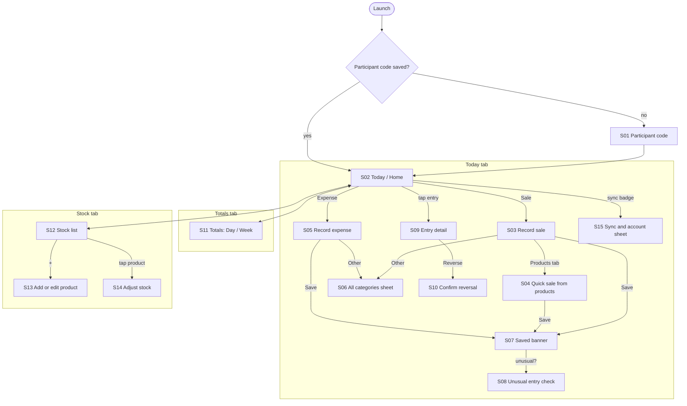

# SFM-LCP — UI design brief for Google Stitch

Version 1 · 24 October 2026 · source of truth for colour, type, hierarchy and flow until it moves
into `mobile/lib/core/theme.dart`.

This brief turns Chapter 3 (requirements FR1–FR12, use cases UC1–UC11, usability tasks T1–T4) into
screens you can generate in Google Stitch and then refine. Section 10 holds paste-ready prompts.
Every colour value here was checked for contrast and colour-blind separation (section 3.2); if you
change one in Stitch, re-run the checks in section 11 before adopting it.

---

## 1. How to use this with Stitch

1. Start each screen with the **global style block** (section 10.1), then paste **one** screen
   prompt from section 10.2. One screen per generation keeps Stitch from inventing navigation.
2. Generate the Home screen first and iterate until the hierarchy feels right; every other screen
   reuses its header, list rows and buttons, so later screens converge faster.
3. Change one thing per iteration ("make the amount larger", "replace the teal with #1D5FA8") and
   note it in the iteration log (section 12). Small, named edits are reversible; rewrites are not.
4. Colour exploration: generate Home and Record expense with Option B, then re-run the same two
   prompts with the Option C block (section 10.3) and compare side by side, in sunlight if you can.
5. When a screen is settled, copy its final hex values and sizes back into section 3–5 here, so
   `theme.dart` is written from this file and not from screenshots.

## 2. Who this is for and what that forces

| Fact (Chapter 3) | Design consequence |
|---|---|
| Market traders and MSME operators in Lusaka, many with limited literacy | Icons and numbers carry meaning; words are short labels. One task per screen, linear flows, no menus inside menus |
| Used outdoors, in market light, on cheap LCD screens | Light theme by default, high contrast, no pale-on-pale text, no thin fonts, no gradients or glass effects |
| 2–4 GB RAM phones (NFR7) | No photos, illustrations or animations beyond simple transitions; vector icons only; one bundled font family at most |
| Works with no network, indefinitely (FR8, NFR3) | Nothing ever waits on the network. Sync state is shown quietly, never as an error |
| Money must never be ambiguous | Every amount shows **sign + colour + icon**; colour is never the only signal |
| Tasks T1–T4 must succeed without help (NFR5) | Each task is reachable from Home in one tap; T4 ("find today's profit") is answered **on Home** |

**Non-negotiables:** touch targets ≥ 56 dp; body text ≥ 18 sp; amounts ≥ 32 sp bold; layouts hold at
360 dp wide and at 1.3× system text size.

## 3. Colour

### 3.1 What the colours must do

Five jobs, in priority order:

1. **Money in vs money out** — the most important distinction in the app.
2. **Selected vs not selected** (category chips, payment method, tabs).
3. **Something needs attention** (an unusual entry, FR4; low stock, FR7).
4. **Brand and neutral actions** (Start, Done, active tab).
5. **Background structure** (screen, cards, borders).

### 3.2 Options measured

Contrast is the WCAG 2.2 ratio against white (4.5:1 needed for normal text, 3:1 for large text and
controls). Colour-blind separation is the CIELAB ΔE between the income and expense colours after
simulating full deuteranopia and protanopia (Machado et al. 2009). Around 1 in 12 men has a red-green
colour deficiency; below roughly ΔE 20 the two colours read as "the same brownish colour".

| Option | Income | Expense | Contrast on white (in / out) | ΔE normal | ΔE deuteranopia | ΔE protanopia |
|---|---|---|---|---|---|---|
| A — current prototype | green `#2E7D32` | red `#C62828` | 5.13 / 5.62 | 100.8 | **15.8** | **18.9** |
| **B — teal / burnt orange (recommended)** | teal `#0F766E` | burnt orange `#C2410C` | 5.47 / 5.18 | 97.2 | 62.4 | 46.2 |
| C — blue / burnt orange (most robust) | blue `#1D5FA8` | burnt orange `#C2410C` | 6.45 / 5.18 | 107.9 | 104.8 | 88.7 |

**Recommendation: Option B.** The current green/red pair is nearly indistinguishable to red-green
colour-blind users, the people most likely to misread a sale as an expense. Teal still reads as
"green = money in", which the low-literacy literature cited in Chapter 3 relies on, while staying
distinct under both common deficiencies. Option C separates best, but breaks the green-means-money
association. Keep it as the challenger to test with participants (section 12), not the default.

**Finding that shapes the attention colour:** amber `#A16207`, the obvious "warning" colour,
collapses into the burnt orange expense under colour blindness (ΔE 2.6 deuteranopia, 7.0
protanopia) in every option. So "attention" is shown as a **highlighter-yellow surface with a dark
border and a warning icon**, never as amber text or an amber button.

### 3.3 Tokens (Option B, light theme)

| Token | Hex | Use | Measured contrast |
|---|---|---|---|
| `ink` | `#1C1C1A` | Primary text, icons, selected chip fill | 15.91 on `surface` |
| `ink-muted` | `#5E5E59` | Times, captions, counters, inactive tab labels | 6.08 on `surface` |
| `surface` | `#F7F7F5` | Screen background | — |
| `card` | `#FFFFFF` | List rows, inputs, unselected chips and keys | — |
| `outline` | `#D6D6D1` | Decorative card borders only | (decorative) |
| `outline-control` | `#8A8A85` | Borders of inputs, keys, unselected chips and toggles | 3.47 on white, 3.23 on `surface` |
| `income` | `#0F766E` | Sale button, income amounts, income icons, Save on a sale | 5.47 on white; white text on it 5.47 |
| `income-tint` | `#E6F2F1` | Disc behind income category icons | teal icon on it 4.78 |
| `expense` | `#C2410C` | Expense button, expense amounts, expense icons, Save on an expense | 5.18 on white; white text on it 5.18 |
| `expense-tint` | `#FBEAE3` | Disc behind expense category icons | orange icon on it 4.43 (icons need 3:1) |
| `brand` | `#1E3A8A` | Start, Done, active tab, focus ring, sync sheet header | 10.36 on white |
| `brand-tint` | `#E8ECF8` | Active tab pill, brand info banners | brand on it 8.77 |
| `attention-surface` | `#FDF3D7` | Unusual-entry and low-stock cards, **always with** a 2 dp `ink` border and warning icon | ink on it 15.42 |
| `disabled-fill` / `disabled-text` | `#E3E3DE` / `#6E6E69` | Disabled buttons | 3.98 |

Rules:

- **Income and expense colours are reserved for money direction.** Never use them for a generic
  button, link, error or brand element. A red "Delete" or a teal "Settings" teaches the wrong meaning.
- **Destructive actions (reverse an entry) are `ink`, not expense-coloured,** and always confirmed.
- **Selected state = `ink` fill with white text plus a check icon,** never colour alone.
- **Amounts always carry their sign:** `+K50.00` in income, `−K25.00` in expense (true minus sign).
- **Tints never carry text smaller than 24 sp**, and never sit on white without a border.
- **Dark theme is out of scope for v1.** Target phones mostly have LCD screens, so it saves no
  battery, and it doubles the contrast checks.

Option C swaps only `income` → `#1D5FA8` and `income-tint` → `#E5EEF8`; to try it, see 10.3.

## 4. Typography

| Token | Size / weight | Use |
|---|---|---|
| `amount-entry` | 44 sp / Bold, tabular figures | The amount being typed |
| `amount` | 32 sp / Bold, tabular figures | Amounts in lists and totals |
| `title` | 22 sp / Bold | Screen titles |
| `label` | 18 sp / Bold | Buttons, chips, row titles |
| `body` | 18 sp / Regular | Inputs, sentences |
| `caption` | 14 sp / Regular, `ink-muted` | Times, counters, "Suggested in…" (the only text under 18 sp) |

**Font:** Atkinson Hyperlegible (Regular and Bold), designed by the Braille Institute so that easily
confused characters (1/l/I, 0/O, 5/S) look different, which matters for amounts and participant
codes. Bundle the two weights as assets. If Stitch doesn't offer it, use the closest available
humanist sans for exploration and switch in `theme.dart`. Alternative: Noto Sans (wider language
coverage if Nyanja/Bemba labels arrive later). Avoid condensed, light or thin weights.

## 5. Space, shape, icons

- **Grid:** 4 dp base. Screen gutter 16; gap between related items 12; tight gaps 6.
- **Shape:** buttons, cards, inputs and keys 16 dp radius; chips and pills fully rounded (28 dp);
  bottom sheets 28 dp top corners.
- **Depth:** flat. 1 dp borders instead of shadows (cheaper to render, clearer in sunlight). The
  only elevation is the bottom sheet scrim.
- **Icons:** Material Symbols Rounded, 24–28 dp in rows, 40 dp in big buttons; filled variant only
  for the selected state. Every icon has a text label beside it, except keypad keys, which get
  spoken labels. Category icons are fixed by the codebook:

| Category | Icon | Kind |
|---|---|---|
| Sales of goods | `shopping_basket` | income |
| Service income | `handyman` | income |
| Other income | `savings` | income |
| Stock purchase | `inventory_2` | expense |
| Transport | `directions_bus` | expense |
| Airtime & data | `phone_android` | expense |
| Rent & market fees | `storefront` | expense |
| Electricity & water | `bolt` | expense |
| Wages | `groups` | expense |
| Meals | `restaurant` | expense |
| Other expense | `more_horiz` | expense |

## 6. Hierarchy

### 6.1 Global order of attention

On every screen, the eye should land in this order:

1. **The money** — the amount being entered, or today's profit on Home.
2. **The one primary action** — Save, Start, Sale/Expense. Exactly one filled, full-width button.
3. **The decision the user must make** — the category, the payment method.
4. **Context** — description, time, sync state.
5. **Machine detail** — suggestion confidence and timing, counters (caption size, muted).

### 6.2 Component rules

- **One filled button per screen.** Secondary actions are outlined; tertiary are text links.
- **The primary action sits at the bottom, inside thumb reach,** pinned above the keyboard or
  keypad; content scrolls behind it.
- **Lists:** icon disc (44 dp) → title (label) over time and payment icon (caption) → amount (right,
  amount style, coloured and signed).
- **Status in the header, never in a modal:** participant code left; sync badge right.
- **Empty states** show one icon, one short line and the action that fills them ("No entries yet").

## 7. Navigation and flow

### 7.1 App map

Three top-level destinations in a bottom bar with icon + label. That's flat, so it respects "no
nested navigation", and it makes Totals (T4) and Stock (UC9–10) one tap away. Recording stays on
Home because it's the most frequent task.



### 7.2 Flows by use case

| Use case | Steps (screens) | Taps from Home |
|---|---|---|
| UC1 Log in (FR11) | S01: type code → Start → S02. First launch only | — |
| UC2 Record sale (FR1) / T1 | Sale → S03: keypad amount → (optional description) → payment → Save → S07 | 1 to start |
| UC3 Quick sale (FR6) / **T1** | Sale → Products tab (S04) → tap Bread three times (×3) → total K75.00 shown → Save | 1 to start; no mental arithmetic |
| UC4 Record expense (FR2) / T2 | Expense → S05: amount → description → suggestion appears → Save | 1 to start |
| UC5 Confirm/correct category (FR3) / T3 | In S03/S05: confident → chip preselected; unsure → 3 chips + Other; Other → S06 grid → pick | 0 extra when confident |
| UC6 Review unusual entry (FR4) | Save → S08 card: "Is K2,500 for Airtime right?" → **Yes, keep** or **Fix it** (→ S10 reversal, then re-enter) | 0 extra when not flagged |
| UC7 Reverse entry (FR12) | Tap entry → S09 → Reverse → S10 confirm → reversal appears as a new, struck-through pair in the list | 3 |
| UC8 Totals (FR5) / **T4** | Today's profit is on S02 itself; Totals tab → S11 for other days and weeks | 0 for today |
| UC9 Manage products (FR6, FR7) | Stock tab → + → S13: name, price, reorder level, opening stock → Save | 2 |
| UC10 Adjust stock (FR7) | Stock tab → product → S14: +/− quantity → reason → Save. Low items show the attention card at the top of S12 | 2 |
| UC11 Sync (FR9) | Automatic. Badge on S02 shows queued count; S15 explains it on tap. Never blocks a task | — |
| UC12 Web dashboard (FR10) | Separate read-only web view; not a phone screen, so not in Stitch | — |

### 7.3 Behaviour rules

- **Back always works and never loses a saved entry.** Leaving a half-filled form asks once:
  "Discard this entry?" (Keep editing / Discard).
- **Saving returns to Home after the 1.5 s "Saved K25.00" banner,** unless S08 needs an answer.
- **An entry is never edited or deleted.** Corrections are reversals (FR12); only the category can
  be changed in S09, which the schema allows.
- **No spinners for local actions.** Saves are instant; sync runs in the background.

## 8. Screen inventory

| ID | Screen | FR / UC | Key content | States to design |
|---|---|---|---|---|
| S01 | Participant code | FR11 / UC1 | Badge icon, "Participant code", large centred input (4–12, auto-caps), Start | Empty, valid, too short |
| S02 | Today (Home) | FR1, FR2, FR5, FR8 | Header (code, sync badge); **today strip: Money in / Money out / Profit**; Sale + Expense buttons; recent entries; bottom nav | Empty day, normal, offline with queued items, an entry flagged unusual |
| S03 | Record sale | FR1, FR3 | Segmented **Amount / Products**; amount display; keypad; description (optional); category chips; Cash / Mobile money; Save (income colour) | Empty, amount only (Sales of goods preselected), suggestion shown |
| S04 | Quick sale from products | FR6 / UC3 | Product tiles (name, price, stock left, − qty +); running total pinned above Save | No products yet (→ add product), items chosen, item out of stock |
| S05 | Record expense | FR2, FR3 | As S03 without Products tab; description required; Save (expense colour) | Empty, confident suggestion, unsure suggestion, Save disabled |
| S06 | All categories sheet | FR3 / UC5 | Bottom sheet, grid of all categories of that kind | Current pick selected |
| S07 | Saved banner | FR1, FR2 | Full-width `ink` banner with check icon, "Saved K25.00", replacing Save (the prototype's green banner breaks the money-colour rule) | Sale, expense |
| S08 | Unusual entry check | FR4 / UC6 | Attention card: icon, "Is this right?", amount, category, "usually about K…", Yes keep / Fix it | — |
| S09 | Entry detail | FR3, FR12 | Big signed amount, category (changeable), payment, time, description, Reverse (outlined, ink) | Normal, already reversed |
| S10 | Confirm reversal | FR12 / UC7 | Dialog: "Cancel this K25.00 expense?" Explains a reversing entry is added. Cancel / Reverse | — |
| S11 | Totals | FR5 / UC8 / T4 | Day / Week toggle; date stepper; Money in, Money out, Profit tiles; by-category list | Day with data, empty day, week |
| S12 | Stock list | FR7 / UC10 | Attention card "2 items running low" when relevant; product rows with stock count; + button | Empty, normal, low stock |
| S13 | Add / edit product | FR6, FR7 / UC9 | Name, price (keypad), reorder level (stepper), opening stock (stepper) | New, edit |
| S14 | Adjust stock | FR7 / UC10 | Product name and current count; − / + quantity; reason chips (Count, Damage, Other); Save | — |
| S15 | Sync and account sheet | FR9, FR11 | Participant code; "12 records waiting to sync"; last synced time; "Sync happens by itself when you have network" | Never synced, waiting, all synced |

## 9. Content and language

- **Labels are one or two words:** Sale, Expense, Save, Start, Other, Totals, Stock.
- **Money is always `K` + amount with two decimals and thousands separators:** `K1,250.00`, never `ZMW`.
- **Times are 24-hour `HH:mm`; dates are `Mon 12 Oct`.**
- **Use no jargon:** "waiting to sync", not "pending outbox"; "cancel this entry", not "reverse
  transaction".
- **Write every string so it can be translated later:** no text baked into images, and room for
  ~30% longer labels.

## 10. Stitch prompts

### 10.1 Global style block (paste before every screen prompt)

```text
Android mobile app, single screen, 390×844 portrait, light theme. App for market traders in
Zambia with limited reading ability, used outdoors on cheap phones. Flat design: no shadows, no
gradients, no photos, no illustrations. Background #F7F7F5; cards and inputs white #FFFFFF with
1px borders #D6D6D1 (decorative) or #8A8A85 (inputs, keys, unselected chips). Text #1C1C1A;
secondary text #5E5E59. Money in (sales/income) colour teal #0F766E; money out (expenses) colour
burnt orange #C2410C; never use these two colours for anything else. Brand colour indigo #1E3A8A
for neutral actions and the active tab. Selected chips are filled #1C1C1A with white text and a
check icon. Font Atkinson Hyperlegible (or a clear humanist sans): titles 22 bold, labels 18 bold,
body 18, captions 14. Amounts in kwacha like "K25.00", bold 32 or larger, always signed "+K50.00"
or "−K25.00". Every touch target at least 56 tall. Corner radius 16 on buttons, cards and inputs;
fully rounded chips. Material Symbols Rounded icons, each with a short text label. Exactly one
filled primary button per screen, full width at the bottom. No status bar mockup.
```

### 10.2 Screen prompts

**S01 Participant code**
```text
First-launch screen. Vertically centred: a large indigo badge/ID-card icon, title "Participant
code", a large white input centred with the code "LSK01" in bold 32 with wide letter spacing and a
counter "5/12" under it at the right, and a full-width indigo "Start" button with an arrow icon.
Nothing else on screen.
```

**S02 Today (Home)**
```text
Home screen. Header: person icon + "LSK01" on the left; on the right a small grey pill with a
cloud-off icon and the number "5" (records waiting to sync). Below, a white "Today" card with three
equal columns: "Money in" +K130.00 in teal, "Money out" −K145.00 in burnt orange, "Profit" −K15.00
in dark text, each with a small arrow icon. Then two large side-by-side buttons 112 tall: teal
"Sale" with a card-plus icon, burnt-orange "Expense" with a cash icon, white text. Then a list of
recent entries as white rounded rows: round tinted icon disc, title, time and a small cash/phone
icon below the title, signed amount on the right: "bus fare to Matero" 08:32 cash −K25.00 (bus
icon); "Sales of goods" 08:32 mobile money +K50.00 (basket icon); "tomatoes from Soweto market"
07:55 cash −K120.00 (box icon); "hair braiding" 07:10 cash +K80.00 (tool icon). Bottom navigation
with three items, icon above label: Today (active, indigo pill), Totals (bar chart), Stock (box).
```

**S03 Record sale**
```text
Record sale screen. Top bar: back arrow, teal card-plus icon, title "Sale". A segmented control
with "Amount" (selected) and "Products". A large white amount display with a teal 2px border,
right-aligned "K50" in bold 44. A 3×4 number keypad of white rounded keys 56 tall: 1–9, a decimal
point, 0, and a backspace icon. An input with a note icon and placeholder "What was sold?" and a
counter "0/120". A row of chips: "Sales of goods" selected (dark fill, white text, basket icon,
check) and an outlined "Other" chip with a grid icon. Two equal toggle buttons "Cash" (cash icon)
and "Mobile money" (phone icon, selected, dark fill). Full-width teal "Save" button with a check
icon pinned at the bottom.
```

**S04 Quick sale from products**
```text
Quick sale screen. Top bar: back arrow, teal card-plus icon, "Sale". Segmented control "Amount" /
"Products" with Products selected. A 2-column grid of white product tiles, each with the product
name in bold, price "K25.00", stock left in small grey text, and a row with a "−" button, the
quantity, and a "+" button (each 56 tall): "Bread" K25.00 qty 3 (left 12); "Sugar 1kg" K32.00 qty 0
(left 6); "Cooking oil 2L" K95.00 qty 0 (left 3); "Kapenta 500g" K60.00 qty 0 (left 0, tile greyed,
"Out of stock"). Above the bottom, a white bar "3 items" and "Total K75.00" in bold 32 teal. Full
width teal "Save" button at the bottom.
```

**S05 Record expense — confident suggestion**
```text
Record expense screen. Top bar: back arrow, burnt-orange cash icon, "Expense". Amount display
with burnt-orange 2px border showing "K25". 3×4 number keypad of white rounded keys. Description
input containing "bus fare to Matero" with counter "18/120". One selected chip "Transport" (dark
fill, white text, bus icon, check) and an outlined "Other" chip. Small grey caption "Suggested
on this phone · 99% sure". Toggle buttons "Cash" (selected, dark) and "Mobile money". Full-width
burnt-orange "Save" button with a check icon at the bottom.
```

**S05b Record expense — unsure suggestion**
```text
Same expense screen, amount "K15", description "Repair of wheelbarrow". Instead of one selected
chip, show three outlined, unselected chips "Other expense" (dots icon), "Stock purchase" (box
icon), "Electricity & water" (bolt icon), plus an outlined "Other" chip with a grid icon. Caption
"Suggested on this phone · 45% sure — pick one". The Save button is disabled: light grey fill
#E3E3DE, grey text.
```

**S06 All categories sheet**
```text
A bottom sheet over the expense screen (dim the screen behind with a 50% dark scrim). Sheet has a
drag handle and a wrapped grid of large outlined chips, each with an icon and label: Stock purchase
(box), Transport (bus), Airtime & data (phone), Rent & market fees (storefront), Electricity &
water (bolt), Wages (people), Meals (fork and knife), Other expense (dots). "Transport" is selected
(dark fill, white text, check).
```

**S07 Saved banner**
```text
The expense screen after saving: everything as before, but the bottom Save button is replaced by
a full-width dark #1C1C1A banner with a white check-circle icon and the text "Saved K25.00" in
bold white. (Neutral, not teal: the money colours only ever mean money in or out.)
```

**S08 Unusual entry check**
```text
A card shown on the Today screen after saving, above the list. Background pale yellow #FDF3D7,
2px dark border #1C1C1A, radius 16. Left: a dark warning-triangle icon. Text: "Is this right?" in
bold, then "Airtime & data −K2,500.00" in burnt orange bold, then "Usually about K20" in grey. Two
buttons side by side: outlined "Fix it" and filled dark "Yes, keep it".
```

**S09 Entry detail**
```text
Entry detail screen. Top bar: back arrow, "Entry". Centred: a large burnt-orange tinted icon disc
with a bus icon, the amount "−K25.00" in bold 44 burnt orange, and "Expense · Mon 12 Oct, 08:32".
White card rows with labels on the left and values on the right: Category "Transport" with a
"Change" text button; Paid with "Cash"; Note "bus fare to Matero". At the bottom, a full-width
outlined dark button "Cancel this entry" with an undo icon.
```

**S10 Confirm reversal**
```text
A dialog over the entry detail screen: title "Cancel this K25.00 expense?", body "The entry stays
in your records and a cancelling entry is added. Your totals will update." Buttons: text button
"Keep it" and filled dark #1C1C1A button "Cancel entry".
```

**S11 Totals**
```text
Totals screen. Top bar title "Totals" with a bar-chart icon. Segmented control "Day" (selected) /
"Week". Date row: outlined left-arrow button, "Mon 12 Oct" bold, disabled right-arrow button. Three
stacked rows: "Money in" K130.00 teal with a down-left arrow icon in a teal tinted disc; "Money
out" K145.00 burnt orange with an up-right arrow in an orange tinted disc; "Profit" −K15.00 in a
dark filled card with white text. Heading "By category" and rows with icon, name and signed
amount: Stock purchase −K120.00, Service income +K80.00, Sales of goods +K50.00, Transport
−K25.00. Bottom navigation: Today, Totals (active), Stock.
```

**S12 Stock list**
```text
Stock screen. Top bar title "Stock" with a box icon and an indigo round "+" button labelled
"Add". At the top a pale yellow #FDF3D7 card with 2px dark border and warning icon: "2 items
running low" with names "Cooking oil 2L — 3 left", "Kapenta 500g — 0 left". Then white product
rows: name, price in grey, and the stock count on the right in bold ("12", "6", "3", "0"); rows at
or below their reorder level show a small warning icon next to the count. Bottom navigation:
Today, Totals, Stock (active).
```

**S13 Add product**
```text
Add product screen. Top bar: back arrow, "New product". Fields, each with a bold label above:
"Name" text input "Bread"; "Price" amount display "K25.00" with an "Edit" button that opens the
number keypad; "Warn me when below" with a − / number / + stepper showing 5; "Stock now" stepper
showing 20. Full-width indigo "Save" button at the bottom.
```

**S14 Adjust stock**
```text
Adjust stock screen. Top bar: back arrow, "Bread". Large "12 in stock" text. A big stepper: "−"
button, the change "+6" in bold 44, "+" button. Label "Why?" and chips: "Counted" (selected),
"Damaged", "Other". A line "New stock: 18". Full-width indigo "Save" button at the bottom.
```

**S15 Sync and account sheet**
```text
A bottom sheet opened from the sync badge. Drag handle; person icon and "LSK01" in bold; a row
with a cloud-off icon "5 records waiting to sync"; a grey line "Last synced: never"; a short
sentence "Your records are safe on this phone. They are sent by themselves when you have
network." A text button "Close". No other actions.
```

### 10.3 Colour iteration prompts

Use these on an existing screen instead of regenerating it:

```text
Option C: change only the money-in colour from teal #0F766E to blue #1D5FA8 everywhere it is
used (buttons, amounts, icon discs with tint #E5EEF8). Keep everything else identical.
```
```text
Option A (baseline for comparison): money in green #2E7D32 with tint #E3F0E4, money out red
#C62828 with tint #F9E5E5. Keep everything else identical.
```
```text
Brand experiment: change the brand colour from indigo #1E3A8A to deep copper #8A3B12 for Start,
Done and the active tab only. Do not change the money colours.
```

The copper experiment is untested for contrast and colour-blind separation. Check it with
section 11 before adopting it, because copper sits near the expense orange.

## 11. Checks before adopting a colour change

1. **Text contrast ≥ 4.5:1** on its background (≥ 3:1 for text 24 sp and larger, icons and control borders).
2. **Colour-blind separation:** income vs expense ΔE ≥ 40 under deuteranopia and protanopia, and
   no role pair under ΔE 20 (any simulator, e.g. Chrome DevTools → Rendering → Emulate vision
   deficiencies; or re-run the script that produced section 3.2).
3. **Grey-scale test:** screenshot in greyscale. Income, expense and selected states must still be
   tellable apart by sign, icon and fill alone.
4. **Sunlight test:** view on a real low-end phone outdoors at the brightness the trader uses.
5. **Layout test:** 360 dp wide and 1.3× system text size, no clipping.

## 12. Iteration log and open decisions

| Date | Screen | Change | Why | Kept? |
|---|---|---|---|---|
| 2026-10-24 | all | Brief v1: Option B colours, bottom nav, today strip on Home | Colour-blind separation; T4 in zero taps | — |
| 2026-10-25 | all | Stitch review: Stitch invented a Card payment, ref and audit IDs and a cash-in-till balance, and used money colours for stock status. Its edits did not save, so the screens were built directly in Flutter (`mobile/`), rendered to `docs/screens/` | Stitch output contradicted the data model; edits not persisted | Yes |
| 2026-10-25 | S05/S03 | Save button shows the amount, e.g. "Save expense (−K25.00)" (adopted from Stitch) | The amount is confirmed at the moment of saving | Yes |
| 2026-10-25 | S13 | The price display is neutral ink, not teal | A price is not money moving | Yes |

Decisions for Shammah:

1. **Option B or C:** test both with 3–5 participants (paper or phone) alongside the icon paper
   test Chapter 3 already plans. Ask "which of these is money coming in?"
2. **Bottom navigation vs a Home-only hub:** the brief recommends three tabs. If participants miss
   the tabs, fall back to large Totals and Stock tiles on Home.
3. **"Suggested … 99%":** show confidence to users, or only to you? The prototype shows timing and
   percentage for the research demo. For traders, "Suggested on this phone" with no number may be
   clearer; keep the number in a debug mode.
4. **Language:** English labels only in v1, or Nyanja/Bemba alongside? This changes label lengths
   (section 9).
